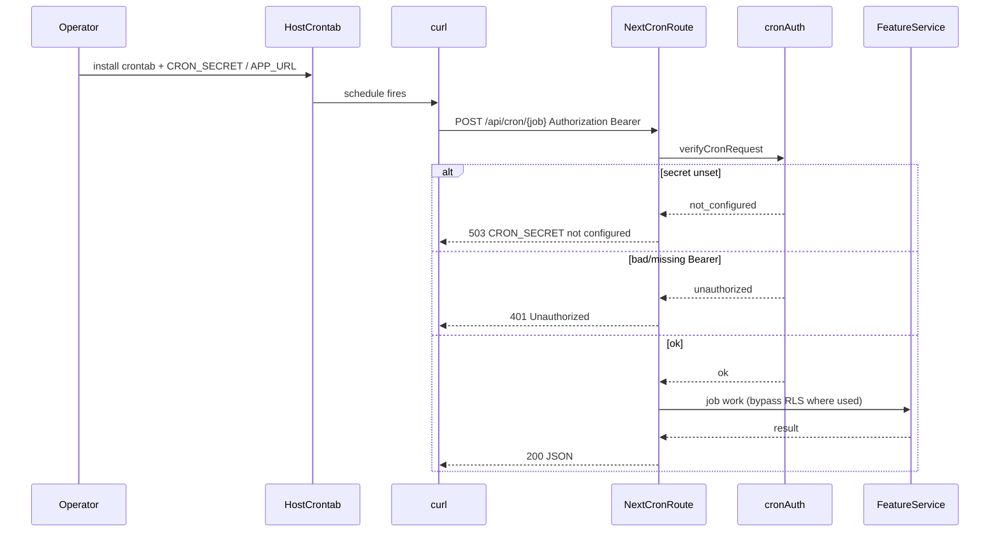

# Design: README cron setup (all features)

**Mode:** simple

## Decision 1: which design approach?

### Option 1 — One README “Cron jobs” runbook (recommended)

**What it is:**
Replace production “### 5. Recurring transactions” with “### 5. Cron jobs (all features)”: shared auth, inventory table, host crontab with four lines, short per-job notes, expanded troubleshooting. Fix local Recurrence + env tables so `CRON_SECRET` is required everywhere. Link deeper docs.

**Example:**
Operator sets `CRON_SECRET` in `.env`, then:

```cron
5 0 * * * curl … "$APP_URL/api/cron/money-recurrence"
0 8 * * * curl … "$APP_URL/api/cron/loan-reminders"
0 18 * * * curl … "$APP_URL/api/cron/investment-quotes"
0 3 * * * curl … "$APP_URL/api/cron/db-housekeeping"
```

**Pros:**
- Meets Metric: one place for all jobs
- Reuses existing host-crontab pattern
- Fixes stale auth in the same edit

**Cons:**
- README grows a bit (mitigate with links)

### Rejected alternative (≤3 lines)

Only patch feature READMEs / `docs/API.md` and leave README Money-only — worse discoverability for deploy operators; fails Outcome.

## Tradeoffs

Optional: Option 1 slightly longer README vs scattered truth. Prefer runbook completeness.

## Recommendation

**Pick Option 1** — day-to-day operator value is finding every schedule from README alone; system convenience of splitting docs loses.

## Chosen design (user-approved)

**Gate B auto** — Option 1 (one README “Cron jobs” runbook). user-first: operators find every schedule in one place.

## System design

**N/A — no system-design change; docs-only README runbook; runtime cron shape unchanged.**

## Sequence diagram

Operator → host crontab → curl → Next cron routes (existing).



## Contracts

### API contracts

**No new contracts.** Document existing endpoints only:

| Method + path | Auth | Request | Success (summary) | Errors |
|---------------|------|---------|-------------------|--------|
| `POST /api/cron/money-recurrence` | Bearer `CRON_SECRET` (all envs) | empty body | `{ processed, generated, errors }` (per current README) | 401 unauthorized; 503 not_configured / db_unavailable |
| `POST /api/cron/loan-reminders` | same | empty | `{ dueCount, installmentsMarked, pushSent, pushFailed }` | same auth/db pattern |
| `POST /api/cron/investment-quotes` | same | empty | `{ data: … }` quote refresh result | 401 / 503 not_configured |
| `POST /api/cron/db-housekeeping` | same | empty | housekeeping result JSON | 401; 503 not_configured / db_unavailable |

**Events / other module APIs:** none for this change.

### Database contracts

**N/A — no schema / migration / query changes.**

### Example queries

**N/A — docs-only.** (Housekeeping SQL lives in `docs/PERFORMANCE.md` if operators need manual prune.)

## Design patterns used

**N/A — no named code pattern; documentation structure only (runbook + point-to-docs).**

## UI / UX / mobile

**N/A — no UI**

## Security design review (OWASP)

Trust boundaries:
- Host crontab / curl → public or loopback app URL; shared secret in `Authorization: Bearer`.

Abuse cases:
- Guessed/leaked `CRON_SECRET` → attacker triggers cross-tenant cron work.
- Secret omitted from app env → all crons fail closed (`503`).

| OWASP | Status | Note |
|-------|--------|------|
| A01 Broken Access Control | pass | Bearer gate on all `/api/cron/*` |
| A02 Cryptographic Failures | pass | Treat secret like password; prefer root-only env file over plaintext crontab |
| A03 Injection | N/A | Docs; no new input surface |
| A04 Insecure Design | pass | Fail closed when secret unset |
| A05 Security Misconfiguration | pass | README must say required all envs (fix stale optional-local) |
| A06 Vulnerable Components | N/A | |
| A07 Auth Failures | pass | Document 401 vs 503; never log full secret |
| A08 Software / Data Integrity | N/A | |
| A09 Logging / Monitoring Failures | pass | Suggest log redirect; avoid echoing secret in shell history notes if useful |
| A10 SSRF | N/A | |

Source: https://owasp.org/Top10/

## Challenges answered

- **Do we need this?** Yes — README is the deploy runbook; fragment elsewhere fails Metric.
- **What fails?** Ops skip jobs; local curls without Bearer; wrong 401-vs-503 guidance.
- **Overspecified?** No — schedules marked suggested; deep prune/API detail linked out.

## Domain / ADR notes

- **Glossary terms used:** none
- **ADR:** N/A — skipped: docs IA easy to reverse; not surprising
- **Grill locks honored:** Grill skipped — frontier empty (see Analyze Settled)

## Build locks (README structure)

1. **Local “### Recurrence (optional)”** — require Bearer; note `CRON_SECRET` in `.env`; keep 5-minute-dev cadence note.
2. **Env tables** — local + prod: `CRON_SECRET` required for all `/api/cron/*` (not money-only; unset → `503`, not “optional”).
3. **Prod §5 title** → `Cron jobs (all features)`.
4. **Shared block:** host has crontab, app image does not; `APP_URL` + Bearer; loopback tip.
5. **Inventory table** (purpose one line each) → four routes above.
6. **Suggested crontab** (examples, editable): money `5 0 * * *`; loans `0 8 * * *`; quotes `0 18 * * *`; housekeeping `0 3 * * *`.
7. **Per-job notes (short):** Money no-backfill / at most one tx; loans need VAPID for push; quotes Yahoo refresh; housekeeping → `docs/PERFORMANCE.md`.
8. **Troubleshoot:** 401 wrong/missing Bearer; 503 secret unset or DB down; money `generated: 0`; loans `pushSent: 0` (no VAPID / no due).
9. **Links:** `docs/API.md` cron rows; feature READMEs optional one-liners already exist — do not duplicate long text.
