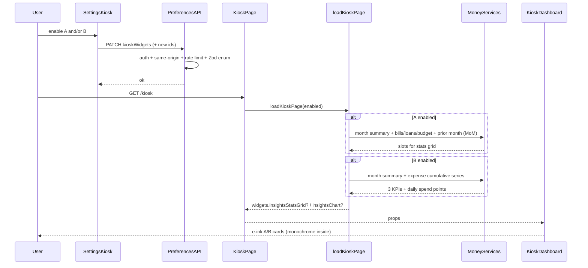

# Design: Kiosk money-insights e-ink widgets (A + B)

**Mode:** full — from `00-run.md`  
**Has API:** yes — extend prefs Zod enum / `kioskWidgets` for two new ids  
**Has DB:** no — `kiosk_widgets` jsonb already stores id arrays; no migration

## Decision 1: which design approach?

### Option 1 — Two systemic widgets (registry + gated loaders + A/B cards)

**What it is:**
Ship two separate registry cells — `money.insights_stats_grid` (Screenshot A) and `money.insights_chart` (Screenshot B) — each with `defaultEnabled: false`. Prefer page-composed payloads from existing Money analytics/budget/loans/bills loaders (month-board pattern). Pure mappers → new card components + extended `.kiosk-eink-*` CSS for footer / dotted rules / dither bars. B chart = visx line, monochrome inside the cell.

**Example:**
User enables A in Settings → PATCH adds `money.insights_stats_grid` → `/kiosk` loaders build 8 KPI slots for this calendar month → card renders 2+3+3 grid + footer “Money” / “Insights · this month”. Same path for B with 3 KPIs + daily spend series.

**Pros:**

- Matches Gate A two-toggle lean and Grill id lock.
- User-first: turn on only the glance they want; month_board stays default.
- Reuses proven gated-loader / registry / Zod prefs pattern; no new money REST or DB.

**Cons:**

- Two cards + two mappers + CSS chrome (more surface than one cell).
- Prefs contract grows (Has API yes) — must bump Zod max with registry length.

### Option 2 — One combined insights cell (creative)

**What it is:**
Single registry id that stacks A’s stats grid and B’s chart in one cell (or tabs inside one card). One Settings toggle.

**Example:**
`money.insights_eink` on → one tall cell shows 2+3+3 then KPIs+chart; one footer.

**Pros:**

- Fewer registry/Zod/settings rows; one enable path.
- Less risk of three money cells crowding the board.

**Cons:**

- Fights Gate A / Grill: two toggles so each glance can run alone.
- Phone cell becomes very tall; chart + 8 KPIs hard to scan.
- Harder 100% side-by-side match to two separate refs.

## Tradeoffs

| Factor | Option 1 | Option 2 |
|--------|----------|----------|
| Cost / time | Medium (two cells + CSS + visx) | Medium (one cell; denser layout work) |
| Complexity | Two mappers / cards; shared CSS chrome | One id; layout/IA compromise |
| Usability | Opt-in A and/or B; month_board clear | Must take both compositions together |
| Failure cases | Prefs enum miss → PATCH strip | Combined cell fails Outcome vs two refs |

## Recommendation

**Pick Option 1** because day-to-day value is “enable the exact ref layout I want.” Two opt-in cells honor Gate A defaults, Grill ids, and 100% fidelity to two screenshots. Option 2 saves a toggle but weakens phone glance and breaks the two-ref Outcome. User value over system convenience: separate toggles beat one combined payload.

## Chosen design (user-approved)

**Option 1 — Two systemic widgets** (Gate B approved 2026-10-15).

Two opt-in registry cells `money.insights_stats_grid` and `money.insights_chart` (default off); gated loaders + pure mappers; e-ink cards matching refs A/B at 100% fidelity; prefs Zod only (Has API yes / Has DB no).

## System design

### Overview

- **What it is:** Two optional `/kiosk` money-insights cells matching TRMNL refs A/B at 100% fidelity; money remapped for this calendar month.
- **Components / boundaries:** Settings → `PATCH /api/user/preferences` (`kioskWidgets` enum grows). `/kiosk` RSC → `load-kiosk-page` → gated loaders/mappers → dashboard cards. No new money HTTP route; no DB migration.
- **Data flow:** Toggle on → prefs persist → page load builds A and/or B payloads only when enabled → client cards render e-ink chrome. Fields: Contracts.
- **Consistency & failure:** Prefs strongly consistent. Empty month → zeros / “—”; no workspace budget → Budget slot unavailable, other A slots still show. Auth/same-origin/rate-limit unchanged.
- **Why this shape:** Systemic branch from analysis; Grill locks (ids, map, series, footer, API/DB).
- **Best practices:** Registry SoT; widget-gated loaders; pure mappers; visx only; skeleton parity; monochrome **inside** cell.
- **Anti-patterns:** New chart lib; theme-tinted “close enough”; default A/B on; rewrite sibling layout/month_board; YouTube/GA/trmnl footer copy.
- **Reference:** `lib/kiosk/*`, ADR-003, DESIGN_GUIDE § Kiosk, `refs/money-insights-*.png`.

### Concept 1 — Widget-gated page compose

- **What it is:** Server builds A/B payloads only when the matching id is in enabled widgets.
- **How we use it here:** Mirror `loadMonthBoardIfEnabled`; share current-month range with month_board where possible.
- **Why we chose it:** Skip finance work when off; testable with injectable loaders.
- **Reference:** `lib/kiosk/month-board.ts`, `load-kiosk-page.ts`.

### Concept 2 — Prefs enum as public API

- **What it is:** `kioskWidgetIdSchema` / `KIOSK_WIDGET_IDS` is the PATCH whitelist for `kioskWidgets`.
- **How we use it here:** Add two ids; `.max(KIOSK_WIDGET_IDS.length)`; `defaultEnabled: false`.
- **Why we chose it:** Multi-device toggles without a new table (Has DB no).
- **Reference:** ADR-003; `validators/user-preferences.ts`.

## Sequence diagram

## Contracts

### API contracts

| Item | Detail |
|------|--------|
| Method + path | `GET` / `PATCH` `/api/user/preferences` (existing) |
| Auth / who can call | Signed-in session user; same-origin; rate limit (unchanged) |
| Request fields (PATCH) | `kioskWidgets?: KioskWidgetId[]` — enum gains `money.insights_stats_grid`, `money.insights_chart`; array max = registry length |
| Success response | Prefs JSON including resolved `kioskWidgets` (unknown ids already stripped on normalize) |
| Errors | `401` / `403` / `400` Zod / rate-limit — existing |
| Downstream | No new money analytics HTTP route; page loaders call existing services |

**Widget payload shapes (page-composed, not new REST):**

| Widget | Payload (conceptual) |
|--------|----------------------|
| A `insightsStatsGrid` | 8 slots: `{ valueDisplay, label, unavailable? }[]` + `range` — order fixed below |
| B `insightsChart` | 3 KPIs same shape + `series: { date: string; spendMinor: number }[]` (daily spend deltas) + `range` |

### Database contracts

`N/A — Has DB = no.` Existing `user_preferences.kiosk_widgets` jsonb stores id arrays; new enum values need no migration.

### Example queries

`N/A — Has DB = no.`

## Design patterns used

### Pattern 1 — Registry SoT + Zod enum

- **What it is:** One id list drives Settings, board, and PATCH validation.
- **How we use it here:** Add two defs with `defaultEnabled: false`; bump max length.
- **Why we chose it:** Prevents orphan toggles and silent strip of unknown ids.
- **Best practices / anti-patterns:** Do not hardcode client-only ids.
- **Reference:** `widget-registry.ts`.

### Pattern 2 — Widget-gated loader + pure mapper

- **What it is:** Gate before fetch; map with pure functions for unit tests.
- **How we use it here:** `loadInsightsStatsGridIfEnabled` / `loadInsightsChartIfEnabled` (+ build\* pure mappers).
- **Why we chose it:** Same as month_board; skips work when off.
- **Best practices / anti-patterns:** Injectable loaders; no finance fetch when disabled.
- **Reference:** `month-board.ts`.

### Pattern 3 — E-ink cell chrome (CSS)

- **What it is:** Shared dither bar, dotted rule, footer band classes for A/B.
- **How we use it here:** Extend `.kiosk-eink-*`; keep monochrome forced inside cell.
- **Why we chose it:** 100% ref fidelity without theme wash.
- **Best practices / anti-patterns:** No gray washes that blur dither; concentric radii tokens on outer Card only.
- **Reference:** `globals.css`, refs A/B.

## UI / UX / mobile

- **UI (when Has UI):** Two kiosk Card cells. Outer Card uses shell tokens (`border-border` / `bg-surface`, `rounded-[var(--radius-md)]`). **Inside** each cell: always black/white e-ink (force ink/paper), not theme-tinted. Shell light/dark stays outside.
- **Build ↔ UI lock:** Build must match Design UI specs below and Gate A #1/#2. Visual SoT = `refs/money-insights-stats-grid.png` (A) and `refs/money-insights-chart.png` (B). Do not re-argue 80/20.
- **80/20 UI:** Important #1 — when A on: 2+3+3 KPI grid with dither bars + row dividers. Important #2 — when B on: 3 KPIs + line chart. Core actions dominant on board (no builder chrome). Settings toggles off-board.
- **Layout / hierarchy:** See locks below.
- **Loading / empty / error / success:** Skeleton shapes mirror A/B layout (parity). Empty month → `0` or `—` (null savings %). No workspace budget → Budget slot “—” / unavailable copy; other slots still render. Not an error toast.
- **Mobile / a11y:** Phone board cell: keep stroke thick; ≤5 X ticks on B; large top KPIs stay readable. Footer decorative. Values `tabular-nums` (global).

### Metric map lock (Grill)

**Period:** this calendar month (same idea as month_board).

**A — `money.insights_stats_grid` (2 + 3 + 3):**

| Row | Slots (L→R) | Labels (ship) |
|-----|-------------|----------------|
| Top (large) | Expenses · Income | Expenses, Income |
| Mid | Net · Savings rate · Bills | Net, Savings %, Bills |
| Bottom | Loans · Budget spent · Expense MoM | Loans, Budget spent, Spend vs last month |

**MoM format:** signed percent vs prior calendar month expenses (e.g. `+12%` / `−8%`); if prior unavailable → `—`.

**B — `money.insights_chart`:**

| Part | Content |
|------|---------|
| KPIs | Expenses · Income · Net |
| Series | **Daily spend** (day-over-day delta of cumulative expense) |
| Range | This calendar month |

### Visual lock — Screenshot A (stats grid)

| Element | Spec (match ref) |
|---------|------------------|
| Structure | Three horizontal bands: top 2 cols → mid 3 → bottom 3 |
| Separators | Two full-width **dotted** horizontal dividers (evenly spaced dots/dashes) between bands |
| Metric atom | Left: thin vertical **dither bar** (checker/stipple ~50% black/white); right: value over label |
| Typography | Top values **largest** bold sans; mid/bottom smaller bold; labels under values, medium/regular, left-aligned with value |
| Footer | Full-width dithered band; left “Money”; right “Insights · this month”; slight bottom corner radius OK |
| Color | Ink on paper only inside cell; greys via dither only |

### Visual lock — Screenshot B (chart)

| Element | Spec (match ref) |
|---------|------------------|
| Header | Three equal KPI columns; each with dither bar + large value + label under |
| Chart | Thick solid black line; **dotted** H+V grid; Y ticks sparse (e.g. 0…max); X labels ~5 date ticks |
| Chart lib | **visx** only (`components/charts/line-chart.tsx` or thin e-ink wrapper) |
| Footer | Same dither band + Money / Insights · this month |
| Color | Monochrome inside cell; black stroke, no multi-series rainbow |

### Registry / defaults

| Id | Label idea | Default |
|----|------------|---------|
| `money.insights_stats_grid` | Money insights grid | **off** |
| `money.insights_chart` | Money insights chart | **off** |

`money.month_board` stays the default money glance. Sibling layout modes unchanged except render hooks.

### Skeleton parity

- A skeleton: 2+3+3 metric-skel rows + dither bar stubs + footer band stub + two dotted rules.
- B skeleton: 3 KPI stubs + chart area stub + footer stub.
- Update `kiosk-dashboard-skeleton` / related in same change as live cards (zero CLS for new cells when enabled; default-only route loading CLS for non-default prefs remains accepted per DESIGN_GUIDE).

## Security design review (OWASP)

Trust boundaries:

- Session user owns prefs PATCH; finance data stays workspace-scoped via existing kiosk loaders (cookie / workspace access).
- Client does not supply workspace id for money loads.

Abuse cases:

- Oversized / unknown `kioskWidgets` → Zod reject / normalize strip.
- Enum growth without max bump → false 400; must keep max = registry length.

| OWASP | Status | Note |
|-------|--------|------|
| A01 Broken Access Control | OK | Existing prefs auth + workspace-scoped money |
| A02 Cryptographic Failures | N/A | No new secrets |
| A03 Injection | OK | Zod enum; no new raw SQL for widget ids |
| A04 Insecure Design | OK | Defaults off; no builder; gated loaders |
| A05 Security Misconfiguration | OK | Same-origin + rate limit unchanged |
| A06 Vulnerable Components | OK | visx already in app; no new chart stack |
| A07 Auth Failures | OK | Session required on prefs |
| A08 Data Integrity | OK | Prefs JSONB replace semantics unchanged |
| A09 Logging/Monitoring | OK | No new PII surfaces beyond existing money mins |
| A10 SSRF | N/A | No new outbound fetches |

See https://owasp.org/Top10/

## Challenges answered

- **Do we need this?** Yes — Outcome is missing ref-faithful money-insights glances; month_board ≠ A/B.
- **What fails?** Soft theme e-ink; wrong remap; A/B default on; chart lib swap; missing skeleton.
- **Is this overspecified?** Visual locks are required for 100% fidelity Outcome; payload stays page-composed to avoid new money API.

## Domain / ADR notes

- **Glossary terms used:** Kiosk insights stats grid / chart (Grill → `GLOSSARY.md`).
- **ADR:** N/A — skipped: map/series/footer/ids easy reverse; prefs already ADR-003.
- **Grill locks honored:** A metric map; B daily spend; ids `money.insights_stats_grid` / `money.insights_chart`; footer Money / Insights · this month; defaults off; Has API yes / Has DB no.

---

**Ask:** Is this design clear? Which option do you approve? Any concerns before build?  
**Confirm:** Has API **yes** · Has DB **no**
