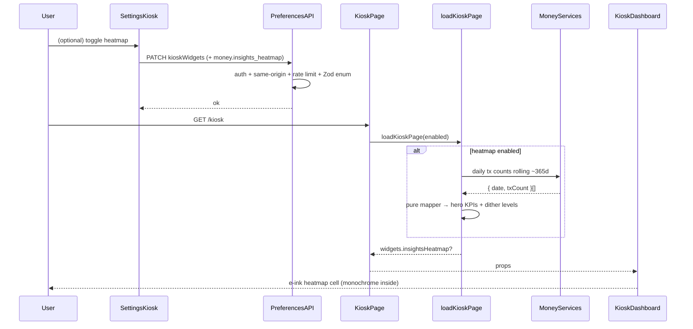

# Design: Kiosk money-insights heatmap widget

**Mode:** full — from `00-run.md`  
**Has API:** yes — extend prefs Zod enum / `kioskWidgets` for `money.insights_heatmap`  
**Has DB:** no — `kiosk_widgets` jsonb already stores id arrays; no migration

## Decision 1: which design approach?

### Option 1 — Systemic new heatmap widget (★)

**What it is:**
New registry cell `money.insights_heatmap` (`defaultEnabled: true`) beside `money.month_board`. Page-composed year payload from existing Money services (thin daily activity grain + pure mapper) → three-band e-ink card matching `refs/money-insights-heatmap.png` at 100% fidelity. Prefs Zod only for public contract; no new money REST / DB.

**Example:**
Fresh prefs → both `money.month_board` and `money.insights_heatmap` on → `/kiosk` loads rolling ~365d daily tx counts → mapper builds hero (active-day count), streaks, peak, average, 4-level dither cells → card renders hero|2×2 → heatmap → footer “Money” / “Insights · last year”.

**Pros:**

- Honors ★ Outcome, Gate A defaults A, and all Grill locks (id, signal, window, footer, empty).
- User-first: year glance appears without a Settings trip; month board stays.
- Reuses registry + gated-loader + e-ink chrome patterns; leaves paused A/B slug untouched.

**Cons:**

- New year daily mapper + contribution-grid CSS (more work than skinning month KPIs).
- Prefs contract grows one enum value (Has API yes).
- Two default-on money cells denser board (settled; Settings can disable).

### Option 2 — Creative merge / amend

**What it is:**
Fold the contribution composition into `money.month_board`, **or** amend paused slug `20261015-kiosk-money-insights-eink` to ship heatmap with A/B.

**Example:**
One tall month cell adds a year heatmap under budget rows; or reopen A/B Gate C and add a third layout there.

**Pros:**

- Fewer registry ids / Settings rows.
- One money “home” cell on the board.

**Cons:**

- Fights settled defaults A, one-job cells, and “do not amend A/B”.
- Month glance ≠ year contribution metaphor; fidelity and IA suffer.
- Mixes scopes; phone cell becomes very tall.

## Tradeoffs

| Factor | Option 1 | Option 2 |
|--------|----------|----------|
| Cost / time | Medium (mapper + grid CSS + skeleton) | Medium–high (IA rewrite or reopen A/B) |
| Complexity | New id + year fill; prefs enum +1 | Couples unrelated layouts / workflows |
| Usability | Default year + month glances; toggle alone | Crowds one cell or mixes A/B ship |
| Failure cases | Prefs enum miss → PATCH strip | Breaks Outcome / Non-goals |

## Recommendation

**Pick Option 1** because day-to-day value is a default-on year activity glance at 100% ref fidelity without touching month_board or the paused A/B ship. User value over system convenience: a dedicated toggleable cell beats merging metaphors.

## Chosen design (user-approved)

**Option 1** — systemic new `money.insights_heatmap` widget (default on beside `money.month_board`), 100% fidelity to `refs/money-insights-heatmap.png`. Gate B yes (chat 13:36).

## System design

### Overview

- **What it is:** One new `/kiosk` money-insights cell matching the contribution-heatmap PNG at 100% fidelity; money activity (tx count) over a rolling ~365d window.
- **Components / boundaries:** Settings → `PATCH /api/user/preferences` (`kioskWidgets` enum +1). `/kiosk` RSC → `load-kiosk-page` → gated year loader + pure mapper → dashboard card. No new money HTTP route; no DB migration.
- **Data flow:** Enabled by default → page load builds heatmap payload when id present → card renders e-ink bands. Fields: Contracts.
- **Consistency & failure:** Prefs strongly consistent. Empty year → zero KPIs + full empty-dither grid + footer (not an error). Auth/same-origin/rate-limit unchanged.
- **Why this shape:** Analysis ★ systemic branch; Grill D1–D6 locked.
- **Best practices:** Registry SoT; widget-gated loaders; pure mappers; monochrome **inside** cell; skeleton CLS parity.
- **Anti-patterns:** Theme gray/accent fills; GitHub/Octocat chrome; spend-as-intensity; YTD-only window; amend A/B; new Money pages/REST.
- **Reference:** `lib/kiosk/*`, ADR-003, DESIGN_GUIDE § Kiosk, `refs/money-insights-heatmap.png`.

### Concept 1 — Widget-gated page compose

- **What it is:** Server builds the heatmap payload only when `money.insights_heatmap` is enabled.
- **How we use it here:** Mirror `loadInsightsChartIfEnabled`; inject loaders for year daily activity.
- **Why we chose it:** Skip year finance work when off; unit-testable.
- **Reference:** `lib/kiosk/insights-chart.ts`, `load-kiosk-page.ts`.

### Concept 2 — Prefs enum as public API

- **What it is:** `kioskWidgetIdSchema` / `KIOSK_WIDGET_IDS` whitelists PATCH `kioskWidgets`.
- **How we use it here:** Add `money.insights_heatmap`; `.max(KIOSK_WIDGET_IDS.length)`; `defaultEnabled: true`.
- **Why we chose it:** Multi-device toggles without a new table (Has DB no).
- **Reference:** ADR-003; `validators/user-preferences.ts`.

## Sequence diagram

## Contracts

### API contracts

| Item | Detail |
|------|--------|
| Method + path | `GET` / `PATCH` `/api/user/preferences` (existing) |
| Auth / who can call | Signed-in session user; same-origin; rate limit (unchanged) |
| Request fields (PATCH) | `kioskWidgets?: KioskWidgetId[]` — enum gains `money.insights_heatmap`; array max = registry length |
| Success response | Prefs JSON including resolved `kioskWidgets` (unknown ids stripped on normalize) |
| Errors | `401` / `403` / `400` Zod / rate-limit — existing |
| Downstream | No new money analytics HTTP route; page loaders call Money services |

**Widget payload (page-composed, not new REST):**

| Field | Shape |
|-------|--------|
| `hero` | `{ value: number; label: string }` — money-active day count |
| `kpis` | 4 slots fixed order: Longest streak · Current streak · Most in a day · Average per day |
| `cells` | `{ date: string; level: 0\|1\|2\|3 }[]` — one per calendar day in window (level 0 = empty dither) |
| `range` | `{ from: string; to: string }` ISO dates for rolling window |
| Footer | UI: left “Money”; right “Insights · last year” (not in payload if shared footer props) |

**Internal data grain (service, not public API):** `{ date: string; txCount: number }[]` for `from`/`to` (workspace-scoped; all kinds). Pure mapper fills missing days with `txCount: 0`.

### Database contracts

`N/A — Has DB = no.` Existing `user_preferences.kiosk_widgets` jsonb stores id arrays; new enum value needs no migration.

### Example queries

`N/A — Has DB = no.`

## Design patterns used

### Pattern 1 — Registry SoT + Zod enum

- **What it is:** One id list drives Settings, board, and PATCH validation.
- **How we use it here:** Add `money.insights_heatmap` with `defaultEnabled: true`; bump max length; leave A/B defaults **false**.
- **Why we chose it:** Prevents orphan toggles and silent strip of unknown ids.
- **Best practices / anti-patterns:** Do not hardcode client-only ids; do not flip A/B defaults.
- **Reference:** `widget-registry.ts`.

### Pattern 2 — Widget-gated loader + pure mapper

- **What it is:** Gate before fetch; map with pure functions for unit tests.
- **How we use it here:** `loadInsightsHeatmapIfEnabled` + `buildInsightsHeatmapWidget` (streaks, buckets, calendar fill).
- **Why we chose it:** Same as month_board / A/B insights; skips work when off.
- **Best practices / anti-patterns:** Injectable loaders; no finance fetch when disabled.
- **Reference:** `month-board.ts`, `insights-chart.ts`.

### Pattern 3 — E-ink contribution chrome (CSS)

- **What it is:** Hero|2×2 dotted rules, vertical-pill day cells, 4 stipple densities, dither footer.
- **How we use it here:** Extend `.kiosk-eink-insights*`; heatmap-specific grid classes; reuse/adapt footer with year copy.
- **Why we chose it:** 100% PNG fidelity without theme wash.
- **Best practices / anti-patterns:** No gray washes; greys via dither only; outer Card keeps shell tokens / `rounded-[var(--radius-md)]`.
- **Reference:** `globals.css`, `refs/money-insights-heatmap.png`.

## UI / UX / mobile

- **UI (when Has UI):** One kiosk Card cell. Outer Card: shell tokens (`border-border` / `bg-surface`, `rounded-[var(--radius-md)]`). **Inside** cell: forced ink/paper e-ink (monochrome); greys via dither/stipple only.
- **Build ↔ UI lock:** Build must match Design UI specs below and Gate A #1/#2. Visual SoT = `refs/money-insights-heatmap.png`. Do not re-argue 80/20. Fidelity = bands, dotted rules, dither levels, footer — not the demo “RYAN” letter art.
- **80/20 UI:** Important #1 — hero (large active-day count + money label). Important #2 — year contribution heatmap. Core actions dominant (passive glance). Settings toggle off-board.
- **Layout / hierarchy:** Top band hero | 2×2 KPIs (dotted H+V rules) → middle week×day pill grid → dither footer.
- **Loading / empty / error / success:** Skeleton mirrors three bands + footer (parity). Empty year → hero `0`, all KPIs `0` / `0.00` avg, full grid at level 0; no empty-copy line. Not an error toast.
- **Mobile / a11y:** Dense year grid OK on phone board; keep pill cells readable; footer decorative; values `tabular-nums` (global).

### Metric map lock (Grill)

**Window:** rolling last ~365 calendar days (inclusive end = today in workspace timezone).

**Primary signal:** activity/tx **count** (not spend).

| Slot | Meaning | Display |
|------|---------|---------|
| Hero | Count of **money-active days** (≥1 tx any kind) in window | Integer + label “Active days in last year” |
| Longest streak | Longest run of consecutive money-active days | Integer days |
| Current streak | Trailing consecutive money-active days ending today (0 if today inactive) | Integer days |
| Most in a day | Max daily **tx count** in window | Integer |
| Average per day | Total tx count ÷ calendar days in window | One decimal (e.g. `2.5`) |
| Heatmap cell | That day’s tx count → dither **level 0–3** | Pill cell |

**Dither buckets (Design lock — Grill residual):**

| Level | Pattern | Rule |
|-------|---------|------|
| 0 | Empty / outline | `txCount === 0` |
| 1 | Light stipple | `txCount === 1` |
| 2 | Dense stipple | `txCount` in 2…3 |
| 3 | Solid black | `txCount >= 4` |

**Empty year:** full calendar grid at level 0; all KPIs zeroed; footer still shown.

### Visual lock — heatmap PNG

| Element | Spec (match ref) |
|---------|------------------|
| Top band | Left: huge bold hero value + label under; right: 2×2 KPI values over labels |
| Separators | 1px **dotted** rules — vertical between hero and 2×2; horizontal under top band |
| Heatmap | ~7 rows (weekdays) × ~52+ week columns; small vertical **rounded pills**; 4 dither densities as above |
| Spacing | Clear whitespace between KPI band and grid (kiosk glance) |
| Footer | Full-width dither bar; left mark + “Money”; right “Insights · last year”; no Octocat / @handle |
| Color | Ink on paper only inside cell; greys via stipple only |

### Registry / defaults

| Id | Label idea | Default |
|----|------------|---------|
| `money.insights_heatmap` | Money insights heatmap | **on** |
| `money.month_board` | (existing) | **on** (unchanged) |
| A/B insights ids | (existing) | **off** (unchanged) |

### Skeleton parity

- Three-band skel: hero stub | 2×2 stubs → heatmap grid stub → footer stub + dotted rule stubs.
- Update `kiosk-dashboard-skeleton` / insights skeletons in the **same** change as the live card (zero CLS).

## Security design review (OWASP)

Trust boundaries:

- Session user owns prefs PATCH; finance data stays workspace-scoped via existing kiosk loaders.
- Client does not supply workspace id for money loads.

Abuse cases:

- Oversized / unknown `kioskWidgets` → Zod reject / normalize strip.
- Enum growth without max bump → false 400; keep max = registry length.
- Year query cost when enabled → gate when off; reuse indexed transaction date filters (no unbounded scan).

| OWASP | Status | Note |
|-------|--------|------|
| A01 Broken Access Control | OK | Existing prefs auth + workspace-scoped money |
| A02 Cryptographic Failures | N/A | No new secrets |
| A03 Injection | OK | Zod enum; service queries stay parameterized |
| A04 Insecure Design | OK | Glance-only; gated loader; no drill-down / builder |
| A05 Security Misconfiguration | OK | Same-origin + rate limit unchanged |
| A06 Vulnerable Components | OK | CSS/SVG dither only; no new chart stack |
| A07 Auth Failures | OK | Session required on prefs |
| A08 Data Integrity | OK | Prefs JSONB replace semantics unchanged |
| A09 Logging/Monitoring | OK | Footer has no PII (fixed copy) |
| A10 SSRF | N/A | No new outbound fetches |

See https://owasp.org/Top10/

## Challenges answered

- **Do we need this?** Yes — year contribution glance is missing; A/B layouts ≠ this composition.
- **What fails?** Soft theme e-ink; spend-as-intensity; GitHub branding; empty looks “broken”; missing skeleton; flipping A/B defaults.
- **Is this overspecified?** Visual + metric locks required for Outcome / Grill; payload stays page-composed to avoid new money API.

## Domain / ADR notes

- **Glossary terms used:** Kiosk insights heatmap; Money-active day (`GLOSSARY.md` already updated in Grill).
- **ADR:** N/A — skipped: signal/window/footer/id/empty easy to reverse; prefs already ADR-003 (`02b-grill.md`).
- **Grill locks honored:** count signal; any-tx streaks; rolling ~365d; footer Money / Insights · last year; empty = zeros + empty dither grid; id `money.insights_heatmap` default on; month_board stays on; Has API yes / Has DB no.

---

**Ask:** Is this design clear? Which option do you approve? Any concerns before build?  
**Confirm:** Has API **yes** · Has DB **no**
