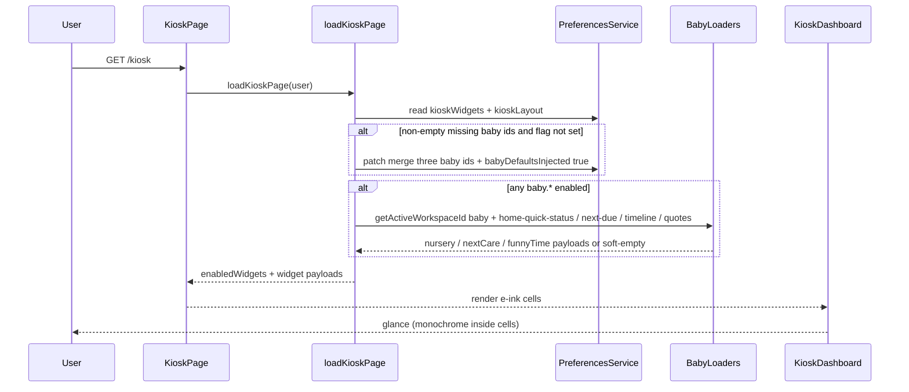

# Design: Baby-care e-ink kiosk widgets

**Mode:** full — from `00-run.md`  
**Has API:** yes — extend prefs Zod (`kioskWidgets` enum + optional `kioskLayout.babyDefaultsInjected`); **no** new baby HTTP routes  
**Has DB:** no — reuse baby loaders + existing `user_preferences` jsonb; **no** migration

## Decision 1: which design approach?

### Option 1 — Three systemic widgets + baby workspace + write-back inject (ADR-004)

**What it is:**
Ship three registry cells — `baby.funny_time`, `baby.next_care`, `baby.nursery` — each `defaultEnabled: true`. Load care data via **baby** workspace (`getActiveWorkspaceId(…, "baby")`), not money. Pure mappers → three e-ink cards matching the three refs at 100% fidelity. One-time write-back inject per ADR-004 when a non-empty saved list omits those ids and `kioskLayout.babyDefaultsInjected !== true`.

**Example:**
Returning parent with saved money widgets opens `/kiosk` → server merges the three baby ids, sets `babyDefaultsInjected: true`, persists → board shows nursery hero + next feed/nap + Funny Time quote beside money cells. Later offs stick (flag true → no re-inject).

**Pros:**

- Matches Gate A Top journey (day-one glance for null **and** typical saved lists) and Grill Q1–Q5 locks.
- User-first: real Home due math (`baby-next-due`), honest hide of schedule/bed time, offs stick.
- Reuses registry / gated load / e-ink chrome / prefs PATCH; money no-inject tests stay green.

**Cons:**

- Write-back on first eligible load (extra prefs write; race if two tabs — flag still eventually true).
- Three default-on cells may crowd a busy money board (order nursery → next-care → Funny Time).
- Prefs contract grows (tiny API) — Zod + Settings Baby group required.

### Option 2 — Thinner data + resolve-merge inject (no flag)

**What it is:**
Same three ids and e-ink chrome, but next-care uses a **last feed/sleep timestamp heuristic** (not `baby-next-due` intervals), and inject is **resolve-merge only** (merge missing baby ids on every resolve; no `babyDefaultsInjected`, no persist).

**Example:**
User turns off Funny Time → next `/kiosk` resolve re-merges all three baby ids → Funny Time returns against their Settings choice.

**Pros:**

- Less code (no flag / write-back path); no prefs mutate on read.
- Heuristic next-care skips interval-guide wiring.

**Cons:**

- Fights Grill Q4 / ADR-004: offs do not stick → broken day-to-day trust.
- Fights Grill Q1: heuristic due is weaker than Home “next in” math parents already know.
- System convenience over user value (easier server, worse Settings).

## Tradeoffs

| Factor | Option 1 | Option 2 |
|--------|----------|----------|
| Cost / time | Medium (3 cells + inject write-back + baby load) | Lower (skip flag + due math) |
| Complexity | ADR-004 path + baby workspace branch | Resolve-merge only; weaker next-care |
| Usability | Day-one board; offs stick; real due titles | Re-inject fights Settings; weaker due |
| Failure cases | One prefs write race (flag settles) | Infinite re-enable after user offs |

## Recommendation

**Pick Option 1** because day-to-day value is “see baby glance on the board without hunting Settings, and keep my offs.” Write-back inject + `baby-next-due` honor Gate A and Grill; Option 2 is easier for the system but worse for parents. User value over system convenience: sticky Settings and real due times beat a merge-only shortcut.

## Chosen design (user-approved)

<!-- Fill after Gate B -->

## System design

### Overview

- **What it is:** Three `/kiosk` baby e-ink cells at 100% ref fidelity; default-on + one-time inject (ADR-004).
- **Components / boundaries:** Registry + Zod prefs → Settings Baby group; `/kiosk` RSC → `load-kiosk-page` (baby workspace) → pure mappers → cards; inject write-back via `patchUserPreferences`.
- **Data flow:** Resolve/inject → gate-load nursery/next-care/funny → render. Fields: Contracts.
- **Consistency & failure:** Prefs strongly consistent after inject write. No baby workspace → soft-empty cells. Hidden next-care due → quiet empty + chrome. `[]` → empty board.
- **Why this shape:** Analysis ★ systemic branch; Grill frontier-empty locks.
- **Best practices:** Widget-gated load; pure mappers; monochrome e-ink inside cell; skeleton parity; money no-inject stays.
- **Anti-patterns:** Money workspace for baby data; booking/investor copy; grey fills vs dither; fake schedule/Solids; re-inject after flag.
- **Reference:** `lib/kiosk/*`, ADR-003/004, DESIGN_GUIDE § Kiosk, `refs/*.png`.

### Concept 1 — Feature-scoped baby workspace on kiosk

- **What it is:** Care loaders run under `workspaceAppKey: "baby"`, not money.
- **How we use it here:** `getActiveWorkspaceId(userSub, "baby")` + `runInWorkspace` when any baby id enabled.
- **Why we chose it:** Wrong cookie → empty/wrong care; Critical if ignored (Analyze).
- **Reference:** `lib/workspace-context.ts`, `load-kiosk-page.ts`.

### Concept 2 — Baby-scoped default inject (ADR-004)

- **What it is:** One-time write-back of three baby ids + done flag; money widgets never inject.
- **How we use it here:** Non-empty stored list omitting any of the three + `babyDefaultsInjected !== true` → merge widgets in registry order **and** persist **full** `kioskLayout` = existing `mode` / `columns` / `focusWidgetId` + `babyDefaultsInjected: true` (never flag-only patch that drops mode/columns/focus). `resolveKioskLayout` + Zod **pass the flag through** (do not rebuild `{ mode, columns, focusWidgetId }` only). Null widgets → defaults; `[]` → empty.
- **Why we chose it:** Day-one glance without re-fighting user offs; flag must survive resolve or inject loops forever.
- **Reference:** `docs/decisions/ADR-004-baby-kiosk-default-inject.md`.

### Concept 3 — Page-composed e-ink cells (no baby REST)

- **What it is:** SSR payloads from existing baby loaders + local quotes; prefs enum is the only public HTTP change.
- **How we use it here:** Mirror money insights `load*IfEnabled` + mapper pattern.
- **Why we chose it:** Matches skim “prefer no new API/DB”; Has API tiny only.
- **Reference:** `features/baby/server/*`, `lib/baby-next-due.ts`.

## Sequence diagram

## Contracts

### API contracts

| Item | Detail |
|------|--------|
| Method + path | `GET` / `PATCH` `/api/user/preferences` (existing) |
| Auth / who can call | Signed-in session user; same-origin; rate limit (unchanged) |
| Request fields (PATCH) | `kioskWidgets?: KioskWidgetId[]` — enum gains `baby.funny_time`, `baby.next_care`, `baby.nursery`; max = registry length. `kioskLayout?:` may include `mode` / `columns` / `focusWidgetId` + optional `babyDefaultsInjected?: boolean`; inject write-back always sends **full** layout object (mode/columns/focus + flag), never flag alone |
| Success response | Prefs JSON including resolved `kioskWidgets` / `kioskLayout` |
| Errors | `401` / `403` / `400` Zod / rate-limit — existing |
| Downstream | **No** new baby HTTP routes; kiosk page loaders call baby server modules |

**Widget payload shapes (page-composed, not new REST):**

| Widget id | Payload (conceptual) |
|-----------|----------------------|
| `baby.funny_time` | `{ quoteLine: string; timePrefix: string }` — never blank on happy path from local time-keyed set |
| `baby.next_care` | See **Next-care display rules** below |
| `baby.nursery` | `{ idCapsule: string; statusTitle; statusSince?; activity: { time; label; detail? }[] (≤4); schedulePill?: never in v1 }` — hide schedule + bed time; under-4 activity → quiet slots |

**Next-care display rules** (from `BabyNextDue` — kinds `next` \| `overdue` \| `hidden`; single `dueAt`; **no** range fields):

| Due kind | `title` | `timeLine` |
|----------|---------|------------|
| `next` | `"Next feed"` or `"Next nap"` (which of feed\|sleep wins soonest) | Local **12h clock of `dueAt` only** (e.g. `12:00 PM`). Do **not** invent end = dueAt+interval or last→due range — SoT has one timestamp; booking-style ranges are out. |
| `overdue` | Same `"Next feed"` \| `"Next nap"` (do not switch to booking copy) | `Overdue · {duration}` using `overdueMs` via the same duration helper as Home (`formatBabyDurationLocale` / `formatBabyNextDueLabel` overdue path). Do **not** show a past start–end window. |
| `hidden` (both dues hidden) | — | Payload `{ empty: true }` — quiet empty + chrome; no title/timeLine. |

Payload when not empty: `{ title; timeLine; updatedAtLabel }` — `updatedAtLabel` = load-clock local 12h for footer `Updated: {time}` (e.g. `04:27 PM`).

**Inject rule (server):**  
`storedWidgets != null && storedWidgets.length > 0 && babyDefaultsInjected !== true && missing any of three` →  
1. `kioskWidgets` = `normalize(merge(storedWidgets, three))`  
2. `kioskLayout` write-back = **full merge** `{ mode, columns, focusWidgetId }` from current stored/resolved layout **+** `babyDefaultsInjected: true`  
3. Persist both.  

`resolveKioskLayout` / layout Zod: accept and return optional `babyDefaultsInjected` (boolean); never drop it on resolve. Money resolve path unchanged (no inject).

### Database contracts

`N/A — Has DB = no.` Existing `user_preferences.kiosk_widgets` / `kiosk_layout` jsonb store ids + flag; no migration / new tables.

### Example queries

`N/A — Has DB = no.` Reads reuse existing baby loader SQL (home-quick-status / timeline / profile) inside baby workspace.

## Design patterns used

### Pattern 1 — Widget-gated `load*IfEnabled`

- **What it is:** Skip loader work when id not enabled.
- **How we use it here:** `loadFunnyTimeIfEnabled` / `loadNextCareIfEnabled` / `loadNurseryIfEnabled`.
- **Why we chose it:** Same as money insights; saves baby queries when offs.
- **Best practices / anti-patterns:** Gate before workspace resolve when all three off; do not load money workspace for baby.
- **Reference:** `lib/kiosk/insights-*.ts`, `load-kiosk-page.ts`.

### Pattern 2 — Pure mapper + unit test

- **What it is:** Fixture → display DTO without React/DB.
- **How we use it here:** Quotes by hour bucket; next-care from `BabyNextDue`; activity map formula→Bottle, breast→Nursing, diaper→Diaper+detail; omit Solids.
- **Why we chose it:** Fast TDD; matches Analyze piece 4.
- **Best practices / anti-patterns:** No fake Solids/schedule; quiet empty slots.
- **Reference:** `lib/kiosk/insights-chart.ts` style; `lib/baby-next-due.ts`.

### Pattern 3 — E-ink footer + dither chrome

- **What it is:** Forced monochrome inside cell; dither bars; footer left/right labels + **per-widget left mark**.
- **How we use it here:** Generalize footer primitive with mark mode (do not reuse money’s always-on mark for every baby cell). Labels + marks locked in UI below.
- **Why we chose it:** 100% fidelity Outcome; theme tint / wrong mark fails refs.
- **Best practices / anti-patterns:** Dither not solid grey; outer Card keeps shell tokens / `rounded-[var(--radius-md)]`; never force money shutter mark on Funny Time.
- **Reference:** `components/kiosk/kiosk-insights-footer.tsx`, `app/globals.css`, DESIGN_GUIDE § Kiosk, `refs/*.png`.

## UI / UX / mobile

- **UI (when Has UI):** Three new glance cells + Settings Baby group toggles. Board order preference: nursery → next-care → Funny Time (registry order among baby ids).
- **Build ↔ UI lock:** Build **must** match Design UI specs below and Gate A #1/#2 — do not re-argue 80/20. **100% design fidelity** vs `refs/funny-time.png`, `refs/next-event.png`, `refs/nursery-dashboard.png` is a hard lock (structure, dither accents, capsules, footer chrome, monochrome).
- **80/20 UI:** Important #1 = nursery Sleeping/Awake hero **or** next-care title **or** Funny Time quote line (per cell). Important #2 = supporting time/activity + footer brand bar. Core = read-only glance; Settings secondary.
- **Layout / hierarchy (locks):**
  - **Funny Time:** centered `timePrefix` + quote; left dither bar; footer **labels only** — Parent \| Funny Time; **no** left mark (ref `funny-time.png`).
  - **Next care:** centered title + `timeLine` per Next-care display rules; no booking/investor/“Next booking”; footer left = **shutter/spiral mark** (same family as money / ref `next-event.png`) + **Baby Care**; right = Updated: {local 12h}.
  - **Nursery:** top ID capsule `Name | age` (no bed time); dither + **Sleeping**/**Awake** + since; 2×2 activity; **no** schedule pill in v1; footer left = **open-circle mark** + **Huckleberry**; right = Nursery (ref `nursery-dashboard.png`).
- **Footer left marks (100% ref fidelity):**

| Widget | Left mark | Left label | Right label |
|--------|-----------|------------|-------------|
| `baby.funny_time` | **none** | Parent | Funny Time |
| `baby.next_care` | shutter/spiral mark (on) | Baby Care | Updated: {local} |
| `baby.nursery` | open circle (hollow) mark (on) | Huckleberry | Nursery |
- **Loading / empty / error / success:** Skeletons mirror live structure (CLS). No baby workspace / hidden due → quiet empty chrome, not crash. Inject success invisible to user (cells just appear).
- **Mobile / a11y basics:** Large type per refs; phone grid already container-query; avoid overlapping hit areas (glance-only). Prefer semantic headings/text over decorative-only status.

## Security design review (OWASP)

Trust boundaries:

- Authenticated prefs GET/PATCH (session + same-origin + rate limit).
- Kiosk SSR reads baby workspace membership only for signed-in user.
- Inject write-back is server-side prefs mutate for that user only.

Abuse cases:

- PATCH forged widget ids → Zod enum reject.
- Cross-workspace baby data via money cookie → prevented by explicit `"baby"` workspace resolve.
- Inject spam → flag stops re-merge after first success.

| OWASP | Status | Note |
|-------|--------|------|
| A01 Broken Access Control | Pass | Session user only; baby workspace membership; no IDOR to other users’ care |
| A02 Cryptographic Failures | N/A | No new secrets/crypto; prefs already session-backed |
| A03 Injection | Pass | Existing ORM/loaders; React text escape for names/quotes; no raw HTML quotes |
| A04 Insecure Design | Pass | Abuse cases above; empty `[]` honored; money no-inject preserved |
| A05 Security Misconfiguration | N/A | No CORS/header changes |
| A06 Vulnerable Components | N/A | No new deps planned |
| A07 Auth Failures | Pass | Unchanged session cookies / prefs auth |
| A08 Software / Data Integrity | Pass | Zod whitelist; normalize strips unknown ids |
| A09 Logging / Monitoring Failures | Pass | Do not log baby PII/care details in inject path |
| A10 SSRF | N/A | No server fetch of user URLs |

Primary: https://owasp.org/Top10/

## Challenges answered

- **Do we need this?** Yes — Core problem: no baby glance on `/kiosk` at screenshot fidelity with default-on.
- **What fails?** Wrong workspace; skip inject; grey instead of dither; booking copy; re-inject after offs; fake schedule/Solids.
- **Is this overspecified?** Three cells match three refs (Gate A). Schedule hide + omit Solids keep scope honest. Option 2 under-delivers Grill locks.

## Domain / ADR notes

- **Glossary terms used:** Kiosk Funny Time; Kiosk next care; Kiosk nursery dashboard; Baby kiosk default inject (`GLOSSARY.md`).
- **ADR:** [`docs/decisions/ADR-004-baby-kiosk-default-inject.md`](../../../docs/decisions/ADR-004-baby-kiosk-default-inject.md) (write-back once + flag). Prefs storage still ADR-003.
- **Grill locks honored:** Q1 soonest feed\|sleep via `baby-next-due` + Next-care display rules (dueAt clock / overdue duration); Q2 hide schedule + bed time; Q3 footers + per-ref left marks; Q4 write-back + full layout merge + flag pass-through; Q5 activity map omit Solids; ids `baby.funny_time` / `baby.next_care` / `baby.nursery`.
