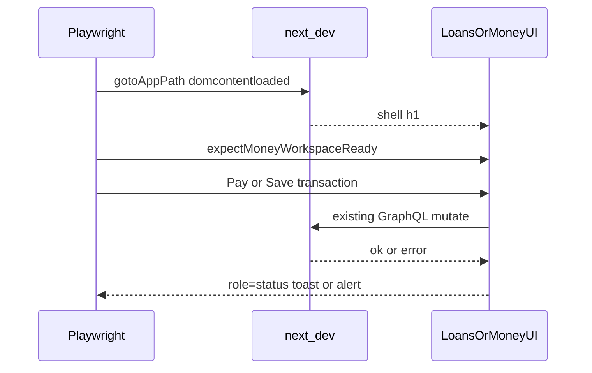

# Design: Fix Loans / Money e2e

**Mode:** simple — from `00-run.md`

## Decision 1: which design approach?

### Option 1 — Nav harden then product write fix (recommended)

**What it is:** Align Loans cold navigations to `gotoAppPath`; re-run; then fix Pay/Money write hang or toast `role=status` until toast asserts pass and cascade stops.
**Example:** `await gotoAppPath(page, "/loans")` in `e2e/loans.spec.ts`; keep `notify.success("Payment recorded in Money")` + e2e `getByRole("status")`.
**Pros:**
- Matches proven Money helper; evidence shows Loans UI already painted under `load` timeout
- Stops false reds so write failures are diagnosable
- Product-first on writes stops webServer die
**Cons:**
- May still need toast markup tweak if notify is not `role=status`
- Write root cause unknown until Build reproduce

### Rejected alternative (≤3 lines)

Timeout-only / skip mutating cases — faster green, hides real hangs and weakens Depth C; rejected because cascade proves server stress and idea prefers product fix when hang is real.

## Tradeoffs

Mode simple: Option 1 preferred — low nav cost, highest chance to stop cascade.

## Recommendation

**Pick Option 1** because evidence splits cleanly: Loans nav = wait strategy; Pay/Money write = product or toast contract after stable nav.

## Chosen design (user-approved)

**Option 1** — Gate B auto (Has API/DB/auth no): Loans cold nav via `gotoAppPath`, then product-first Pay/Money write/toast fixes.

## System design

**N/A — no system-design change; e2e helpers + existing Loans/Money UI/notify paths only.**

## Sequence diagram

## Contracts

### API contracts

N/A — Has API = no (no new endpoints; existing GraphQL pay / money create unchanged in contract).

### Database contracts

N/A — Has DB = no.

### Example queries

N/A.

## Design patterns used

### Pattern 1 — Cold goto with compile-safe wait

- **What it is:** Navigate with `waitUntil: "domcontentloaded"`, retry on abort/timeout, optional compile idle.
- **How we use it here:** Replace bare `page.goto` in Loans e2e (and Pay open-flow) with `gotoAppPath`.
- **Why we chose it:** Money already uses it; Loans `load` hang with painted UI matches helper comments.
- **Best practices / anti-patterns:** Do not raise timeouts instead of fixing wait strategy; do not wait for full `load` on ATF skeleton pages.
- **Reference:** `e2e/helpers/shell.ts` → `gotoAppPath`

### Pattern 2 — Soft error then success toast

- **What it is:** Soft-assert no error alert quickly; then require success `role=status` toast text.
- **How we use it here:** Keep existing Pay / add-tx asserts; fix product if toast never mounts.
- **Why we chose it:** Grill lock — toast is Depth C success signal.
- **Best practices / anti-patterns:** Do not drop toast assert for ledger-only check without product reason.
- **Reference:** `e2e/loans.spec.ts`, `e2e/money.spec.ts`

## UI / UX / mobile

- **UI (when Has UI):** Only if toast markup/role must change to match `getByRole("status")` — keep existing copy strings.
- **Build ↔ UI lock:** Success strings stay `Payment recorded in Money` and `Transaction added`; status role required for e2e.
- **80/20 UI:** #1 navigation reaches Loans/Money shell; #2 write success toast visible
- **Layout / hierarchy:** no layout change expected
- **Loading / empty / error / success:** keep loading statuses; error = `role=alert`; success = `role=status` toast
- **Mobile / a11y basics:** toast must remain announceable (`status` / live region per existing notify)

## Security design review (OWASP)

Mode simple + low risk — light note.

Trust boundaries:
- Unchanged auth jar for e2e; no new public surface

Abuse cases:
- N/A for this fix

| OWASP | Status | Note |
|-------|--------|------|
| A01–A10 | N/A | No new auth/input/API/schema; https://owasp.org/Top10/ |

## Challenges answered

- Do we need this? Yes — Loans/Money Depth C red blocks merge confidence.
- What fails? Loans `load` goto; Pay toast; Money add-tx then server cascade.
- Is this overspecified? No — two patterns, no new system shape.

## Domain / ADR notes

- **Glossary terms used:** none new
- **ADR:** N/A — skipped: easy to reverse e2e/helper choice
- **Grill locks honored:** toast success signal; product-first writes; Loans `gotoAppPath`

## Flags (confirm)

- **Has API:** no
- **Has DB:** no
- **Has auth/PII/schema:** no
- **Has UI:** yes
