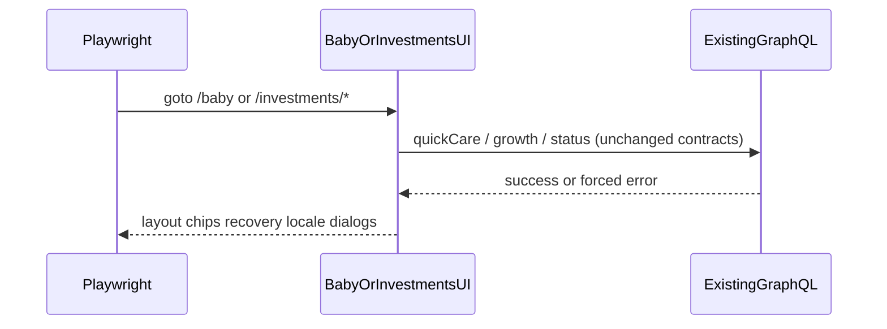

# Design: Fix remaining baby + investments e2e

**Mode:** simple — from `00-run.md`

## Decision 1: which design approach?

### Option 1 — Cluster restore (product-first Option B + capture + client recovery; e2e only for scope/flake)

**What it is:** Fix home layout/chips, locale H1, Custom dismiss, Growth/Activities, under-owner pending in client/UI; scope dual wet in e2e; investments: isolate then harden goto if flake.

**Example:** Shared nap|diaper row so `|Δy| < 48`; dialog closes after Use; `pendingRecoveryUnder(page, "diaper")` visible after ambiguous fail; investments retry `page.goto` only after alone-green.

**Pros:**
- Honors locked Option B + existing red e2e as repro
- No API/DB/auth flip; Gate B can stay auto on simple low-risk path
- Clear task clusters for Build

**Cons:**
- Multi-file baby home touch needs skeleton parity
- Investments path may still need a second pass if alone-red

### Option 2 — Rejected alternative (≤3 lines)

Rewrite geometry/locale/recovery asserts to match current stacked UI and skip investments under stress. Faster green, but abandons Option B / VI / recovery contracts and hides real UX drift.

## Tradeoffs

Mode simple: Option 1 costs more Build time; Option 2 is cheaper and wrong for product locks.

## Recommendation

**Pick Option 1** because Grill settled product restore for Option B and capture, with e2e only for strict-mode scope and proven suite flake.

## Chosen design (user-approved)

<!-- Fill after Gate B -->

## System design

**N/A — no system-design change;** client/UI + Playwright only; existing GraphQL quick-care/growth stay as-is.

## Sequence diagram

## Contracts

### API contracts

N/A — Has API = no (no new/changed endpoints or mutation shapes).

### Database contracts

N/A — Has DB = no.

### Example queries

N/A.

## Design patterns used

### Pattern 1 — Option B data-section / data-layout anchors

- **What it is:** Stable `data-section` / `data-layout` for geometry and recovery locators.
- **How we use it here:** Restore row wrappers so e2e geometry and under-owner queries keep working.
- **Why we chose it:** Specs already bind to these hooks.
- **Best practices / anti-patterns:** Do not remove testids for flake avoidance; fix chrome instead.
- **Reference:** `components/baby-home.tsx`, `e2e/baby-home-option-b.spec.ts`

### Pattern 2 — Under-owner pending recovery

- **What it is:** Recovery UI scoped under the care section that owns the pending write.
- **How we use it here:** Diaper (and peers) show `baby-home-pending-recovery` on ambiguous fail / mid-save reload.
- **Why we chose it:** Matches chain/reload/clear e2e contracts.
- **Best practices / anti-patterns:** Do not only show page-level chainFailed for INTERNAL_SERVER_ERROR when under-owner is required.
- **Reference:** `data-testid="baby-home-pending-recovery"`

### Pattern 3 — Scoped e2e locators

- **What it is:** Click within `data-section` or `getByRole('dialog')` when attrs duplicate.
- **How we use it here:** Wet kind + Custom time paths.
- **Why we chose it:** Strict-mode dual wet is a locator hygiene issue when both surfaces exist.
- **Best practices / anti-patterns:** Prefer scope over deleting product chips.
- **Reference:** diaper Custom failures in terminal log

## UI / UX / mobile

- **UI (when Has UI):** Baby home Option B: row1 breast+bottle; row2 nap|diaper same band; pump below; bottle ml chips present with large hit targets; Custom chip excluded from ≥56 rule as today.
- **Build ↔ UI lock:** Any home structure change updates `baby-page-skeleton` / related skeletons same PR; concentric radii tokens unchanged.
- **80/20 UI:** Important #1 care taps (breast/bottle/nap/diaper); #2 recovery Try again / discard under owner.
- **Layout / hierarchy:** Subgrid / auto-fit; Nap left of Diaper on desktop width used by Playwright.
- **Loading / empty / error / success:** Pending recovery under owner; birthday/settings error tokens → local copy (existing); no new empty states.
- **Mobile / a11y basics:** Care controls ≥44px (e2e ≥56 where asserted); locale radio updates H1.

## Security design review (OWASP)

Mode simple + Has auth/PII/schema = no — light pass.

Trust boundaries:
- Existing session cookie for e2e; no new auth surfaces.

Abuse cases:
- None new; do not weaken auth skips.

| OWASP | Status | Note |
|-------|--------|------|
| A01–A10 | N/A / unchanged | No new inputs, auth, or data stores. https://owasp.org/Top10/ |

## Challenges answered

- Do we need this? Yes — 19 red block full-suite confidence.
- What fails? Layout, locale, Custom, Growth/Activities, recovery, late investments goto.
- Is this overspecified? No — tasks map 1:1 to failure clusters; no API redesign.

## Domain / ADR notes

- **Glossary terms used:** none new
- **ADR:** N/A — skipped: fix-only, easy to reverse
- **Grill locks honored:** from `02b-grill.md` (Q1–Q4)

## Has flags (Design confirm)

- **Has API:** no
- **Has DB:** no
- **Has auth/PII/schema:** no
