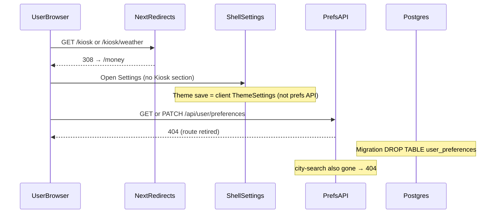

# Design: Remove kiosk (full teardown)

**Mode:** full — from `00-run.md`

## Decision 1: which design approach?

### Option 1 — Systemic full teardown (required)

**What it is:** Delete the kiosk product surface end-to-end: shell nav + `/kiosk` routes, Settings kiosk/weather blocks, prefs API + `user_preferences` table, city-search + weather packages, e2e/unit for kiosk, docs/ADRs/glossary. Permanent redirect old URLs to Money home. Keep shared Popover/MoreMenu.
**Example:** Remove `shellNavItems` kiosk entry; strip Settings `kiosk` category; delete `/api/user/preferences` (+ city-search); migration `DROP TABLE user_preferences`; `next.config.ts` `{ source: "/kiosk", destination: "/money", permanent: true }` (+ `:path*`).
**Pros:**
- Matches product Option 2 and ★ systemic branch — no dead board in daily nav/Settings
- One cut: no ghost API/DB/docs drift
- Bookmark story is clear (land on Money, not a broken page)
**Cons:**
- Larger change set; Settings theme stays on client ThemeSettings (not this prefs bag)
- Irreversible layout/weather data loss (accepted at Gate A)

### Option 2 — Soft-deprecate / keep weather path

**What it is:** Hide or stub kiosk UI but keep prefs columns, weather city Settings, or a “coming soon” page; or redirect temporarily / to `/money/new`.
**Example:** Nav omit only; leave `kiosk_*` / `weather_*` in schema; temporary redirect or 404.
**Pros:**
- Smaller first PR; weather “for later”
**Cons:**
- Fights Gate A + Grill settled locks and Decision N Option 2
- Leaves maintenance and Settings/API debt; confuses bookmarks

## Tradeoffs

| Factor | Option 1 | Option 2 |
|--------|----------|----------|
| Cost / time | Med-high one pass | Low now, high later |
| Complexity | Ordered cut (UI→API→DB→docs) | Partial surfaces diverge |
| Usability | Clean nav/Settings; redirect to Money | Dead ends / clutter remain |
| Failure cases | Incomplete strip breaks Settings | Ghost fields + false green e2e |

## Recommendation

**Pick Option 1** because day-to-day users need a clean shell and Settings without a retired board — not system convenience of leaving columns “for later.” User value over keeping unused prefs/weather.

## Chosen design (user-approved)

**Option 1** — systemic full teardown (Gate B: user "yes Option 1, go build").

## System design

### Overview

- **What it is:** Feature teardown of retired core kiosk (+ kiosk-only weather) without touching Money/Baby workspace bootstrap.
- **Components / boundaries:** Shell registry/crumbs → Settings chrome → delete prefs HTTP + service → `DROP TABLE user_preferences` → redirects in `next.config.ts`; delete `components/kiosk`, `lib/kiosk`, `components/weather`, `lib/weather`, city-search route.
- **Data flow:** Prefs bag today is **only** kiosk/weather (`SerializedUserPreferences` + six columns). Retire the resource; theme stays client `ThemeSettings`; account/workspace use other surfaces. Old `/kiosk*` never hit deleted pages (redirect first).
- **Consistency & failure:** Ship DROP TABLE with API/UI cut; leftover callers of prefs route → **404**; incomplete Settings strip → runtime import crash (task order mitigates).
- **Why this shape:** Live table has no non-kiosk/weather columns; empty bag or PK-only leftover has no product job. No new API surface; core item removed without inventing `WorkspaceAppKey`.
- **Best practices / anti-patterns:** Forward DROP TABLE only (do not rewrite `0036`/`0048`); do not claim theme/account live on prefs; do not stub “coming soon.”
- **Reference:** `docs/ARCHITECTURE.md` (core vs feature); ADR-006; `next.config.ts` redirects; `db/schema/user-preferences.ts`.

### Concept 1 — Ordered feature teardown

Delete consumers before packages (Settings → delete kiosk modules); retire prefs API before/with table drop; redirects before relying on 404.

### Concept 2 — Prefs resource retire

Authenticated prefs GET/PATCH today only serve kiosk/weather. Remove the route + service; do not leave a fake empty bag or PK-only table.

### Concept 3 — Retired URL → home

Permanent redirect of gone product paths to the next useful home (`/money`), not a write form.

## Sequence diagram



## Contracts

### API contracts

| Item | Detail |
|------|--------|
| Method + path | **Retire** `GET` / `PATCH` `app/api/user/preferences/route.ts` (+ delete `lib/user-preferences-service.ts`, `lib/validators/user-preferences.ts` and tests). Not an empty `{}` bag — that resource had only kiosk/weather fields. |
| Auth / who can call | N/A after delete — no prefs mutate surface left |
| Request / response | Gone. Do **not** keep “theme/account/date/workspace” on this API — those never lived here (theme = client `ThemeSettings`; account/workspace = other surfaces). |
| Rejected alternative | Empty bag: `GET { data: {} }` + `PATCH z.object({}).strict()` → `{}` only — rejected because DB end-state is DROP TABLE (no row store left). |
| Errors after cut | Callers of retired prefs or city-search → **404**. (While route still existed, stale keys would have been 400 `.strict()`; after retire, 404 is enough.) |
| Downstream calls | **Delete** `app/api/user/preferences/city-search`; no Open-Meteo from prefs/Settings |
| Redirects (config) | Permanent: `/kiosk` → `/money`; `/kiosk/:path*` → `/money` in `next.config.ts` |

### Database contracts

| Table / collection | Purpose | Key fields | Indexes / uniques | Write owner | Read owners |
|--------------------|---------|------------|-------------------|-------------|-------------|
| `user_preferences` | **DROP TABLE** (preferred end-state) | Today: PK `user_sub` + six kiosk/weather columns only — **no** other prefs columns. After cut: table gone. | N/A after drop | none | none |
| New migration | Forward `DROP TABLE` (+ remove Drizzle schema file / exports) | Journal after latest | N/A | migrate deploy | remove from ARCHITECTURE table list in docs task |
| Rejected alternative | PK-only leftover table — no product fields; avoid unless a later prefs bag needs the name |

**Deploy order:** App must not SELECT dropped columns / table — ship API+schema cut with migrate (same release OK if ordered: stop reads → DROP).

### Example queries

```sql
-- Happy path: table only held kiosk/weather; drop whole table
DROP TABLE IF EXISTS user_preferences;
```

```ts
// After cut — no userPreferences schema import; prefs service deleted
// Theme: client ThemeSettings only
```

## Design patterns used

### Pattern 1 — Config redirects

- **What it is:** Next.js `redirects()` for retired URLs.
- **How we use it here:** Same shape as money/baby URL moves; permanent `/kiosk` (+ children) → `/money`.
- **Why we chose it:** Bookmark safety without keeping pages.
- **Best practices / anti-patterns:** Do not target `/money/new`; do not use temporary redirect.
- **Reference:** `next.config.ts`; ADR-006.

### Pattern 2 — Retire empty prefs resource

- **What it is:** Remove an authenticated bag when every field is product-retired.
- **How we use it here:** Delete prefs route + validators + service with kiosk/weather; DROP TABLE.
- **Why we chose it:** Empty `{}` API + PK-only table would be dead weight.
- **Best practices / anti-patterns:** Do not claim theme/account stay on this route; delete city-search with weather.
- **Reference:** `app/api/user/preferences/route.ts`, `db/schema/user-preferences.ts`.

### Pattern 3 — Core nav delete-only

- **What it is:** Remove a core `shellNavItems` entry without workspace bootstrap.
- **How we use it here:** Drop kiosk from registry + crumbs/chrome-path; Money remains first useful home.
- **Why we chose it:** Architecture: core has no `WorkspaceAppKey`.
- **Best practices / anti-patterns:** Do not invent feature bootstrap for removed item.
- **Reference:** `lib/features/registry.ts`, `docs/ARCHITECTURE.md`.

## UI / UX / mobile

- **UI (when Has UI):** Teardown only — no new screens. Remove Kiosk from shell nav; delete `/kiosk` (+ weather) pages/skeletons; strip Settings `id="settings-kiosk"` / Kiosk category and weather-city block; purge `.kiosk-*` CSS; retire DESIGN_GUIDE “Kiosk glance pattern.”
- **Build ↔ UI lock:** Build **must** match these Design UI specs (Gate A #1/#2). Do not ship stub/coming-soon kiosk page. Do not leave empty “Kiosk” headings.
- **80/20 UI (when UI):**
  - **#1 always visible:** Remaining shell nav (first useful feature = Money at registry order after kiosk gone).
  - **#2 always visible:** Settings sections that still matter (theme/account/etc. via their real surfaces) — not widgets/layout/weather.
- **Layout / hierarchy:** Settings category list without kiosk; shell active states only for remaining items; follow DESIGN_GUIDE tokens for leftover Settings/shell (`data-style="quiet"`, semantic colors, concentric radii).
- **Loading / empty / error / success:** No kiosk skeletons. Theme save stays client ThemeSettings. Old `/kiosk*` → redirect. Retired prefs URL → 404.
- **Mobile / a11y basics:** Shell + Settings usable on phone; no orphan edit strips/menus; hit areas unchanged on remaining controls; keep shared Popover/MoreMenu for other callers.

**WIP inventory (Build):**

| Keep | Delete / discard |
|------|------------------|
| `components/ui/popover*`, `popover-dismiss`, `more-menu` (+ tests) | All `components/kiosk/*`, `lib/kiosk/*`, weather packages, kiosk e2e, kiosk-only WIP |
| Money/Baby/Settings non-kiosk | Prefs route/service/validators; `user_preferences` table; paused kiosk workflow Gate B work |

## Security design review (OWASP)

Trust boundaries:
- Prefs HTTP surface removed (was authenticated GET/PATCH)
- Browser → Next redirects (no auth change for redirect itself)
- DROP TABLE removes stored weather location PII

Abuse cases:
- Unauthenticated prefs mutate → no route left (404)
- Stale clients calling removed prefs/city-search → 404, no silent re-store
- IDOR on prefs → N/A after table+route gone

| OWASP | Status | Note |
|-------|--------|------|
| A01 Broken Access Control | Pass | Prefs surface removed; no widen |
| A02 Cryptographic Failures | N/A | No crypto change |
| A03 Injection | Pass | Fixed SQL DROP TABLE; no new dynamic SQL |
| A04 Insecure Design | Pass | Drop location PII with weather; no stub board |
| A05 Security Misconfiguration | Pass | Clean auth.ts kiosk matcher comment with routes |
| A06 Vulnerable Components | N/A | No new deps; may remove weather client usage |
| A07 Auth Failures | Pass | No prefs auth surface left |
| A08 Data Integrity | Pass | Migration + app cut together |
| A09 Logging/Monitoring | Pass | Do not log deleted prefs PII |
| A10 SSRF | Pass | Delete city-search geocode path |

See https://owasp.org/Top10/

## Challenges answered

- **Do we need this?** Yes — product retired the board; shipping it costs daily trust and maintenance.
- **What fails?** Settings still importing deleted kiosk modules; service still selecting dropped table; deploy without migration.
- **Is this overspecified?** No — Option 2 soft-path reopens settled Grill; Design locks redirects + ADR-006 + retire prefs + DROP TABLE.

## Domain / ADR notes

- **Glossary terms used:** None kiosk-specific (purged per Grill); shell nav, Money home; prefs resource retired with table.
- **ADR:** `docs/decisions/ADR-006-kiosk-removed-redirect-money.md` (Accepted). ADRs 003–005 → Superseded.
- **Grill locks honored:** Permanent `/kiosk` + children → `/money`; drop weather; layout data loss OK; keep Popover/MoreMenu. Stale-key 400 lock → superseded by full route retire (404); same intent (no silent kiosk/weather store).
