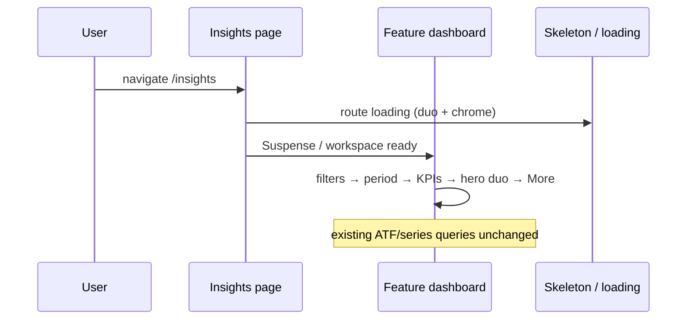

# Design: Insights UI — money-style hero (baby / investments / loans)

**Result:** done

**Mode:** simple · profile lite  
**Has UI / API / DB / auth/PII/schema:** yes | no | no | no

## Decision 1: how to apply money hero without a third ATF chart

### Option A — Adapted duo with shared hero tokens (recommended)

**What it is:** Reuse money’s `ANALYTICS_HERO_ROW_GRID`, `ANALYTICS_HERO_SPEND_CLASS`, and `ANALYTICS_HERO_SIDE_CLASS`. Place the domain primary in the tall ~2/3 slot (`CHART_CARD_HEIGHT_TALL` + `CHART_CARD_HEIGHT_FILL`). Place the single peer chart in one side slot (`CHART_CARD_HEIGHT_HALF`, `lg:row-start-1`). Do **not** invent a third ATF chart. Extend chart skeletons so ATF paints the same duo (not money’s full triad).

**Example:** Investments ATF:

```tsx
<div className={ANALYTICS_HERO_ROW_GRID}>
  <InvestmentResultsOverTimeCard className={ANALYTICS_HERO_SPEND_CLASS} /* tall+fill */ />
  <InvestmentAllocationCard className={cn(ANALYTICS_HERO_SIDE_CLASS, "lg:row-start-1")} />
</div>
```

**Pros:** Matches Grill; reuses tokens; no fake insight; DESIGN_GUIDE “one job” held; CLS fixable with duo skeleton.

**Cons:** Live money still uses triad — feature skeletons diverge from money’s third side slot unless duo mode is explicit.

### Option B — Clone full money triad (promote a third ATF chart)

**What it is:** Keep `AnalyticsCollapsedGridContent` triad shape. Promote one “More insights” chart (or a teaser-as-chart) into the second side slot so live matches money skeleton 1:1.

**Example:** Loans ATF = Remaining + Paid P/I + Combined payoff (pulled from More).

**Pros:** Live and money skeleton identical; maximum visual clone of money.

**Cons:** Violates Grill (no fake/third ATF); weakens “one job”; bigger scope and more fetches/UI.

## Tradeoffs

| Factor | Option A | Option B |
|--------|----------|----------|
| Cost / time | Low–medium (layout + skeleton prop) | Medium–high (third chart + More reshuffle) |
| Complexity | Duo skeleton mode | New ATF chart wiring per app |
| Usability | Clear primary + peer | Three ATF jobs compete |
| Failure / CLS | Must ship duo skeleton with live | Triad skeleton already exists |

## Recommendation

**Pick Option A — adapted duo.** Grill Round 1 accepted this; Option B invents ATF content Grill rejected.

## Chosen design (Grill closed)

**Option A** — adapted duo + per-app primary from Grill.

## Locked picks

| Topic | Pick |
|-------|------|
| Layout | Adapted duo (`ANALYTICS_HERO_*`); teasers / More unchanged in role |
| Skeleton | Duo ATF parity (primary + one side) — **not** a blank third chart slot |
| Investments hero | Results over time; side = Allocation |
| Loans hero | Remaining by loan; side = Paid principal vs interest |
| Baby hero | Night rest; side = Hydration |
| Baby order | cue → filters → period → **KPIs** → hero duo → More (pattern / growth / extra charts stay in More) |
| Loans route loading | `FeatureInsightsPageSkeleton showUrgencyStrip` (match dashboard) |
| API / DB / auth | No changes |

## System design

### Overview

- **What it is:** Client-only layout hierarchy change on three Insights dashboards + matching skeletons / route `loading.tsx`. Same queries, cards, drilldowns, empty/error, and More teasers.
- **Boundaries:** UI components under `components/*insights*` and `components/money-analytics-skeleton.tsx` / `baby-page-skeleton.tsx`. Money Insights stays the reference and is **not** redesigned.
- **Data flow:** Unchanged — ATF / series queries already power these cards.
- **Consistency & failure:** Existing empty/error paths stay; hydration low-wet alert stays after ATF charts (or immediately after hero row — keep current relative placement vs hydration).
- **Why this shape:** Grill locked duo + baby primary/KPI order; DESIGN_GUIDE Insights “one job” + skeleton parity rules.
- **Anti-patterns:** Equal 2-up ATF; money triad skeleton over duo live; hard-coded hex / one-off radii; promoting More charts into ATF without product need.

### Page order (target)

| App | Stack |
|-----|--------|
| Investments | filters → period → KPIs → adapted-duo charts → More teasers |
| Loans | filters → period → urgency strip → KPIs → adapted-duo charts → More teasers |
| Baby | activities cue → filters → period → **KPI cards (count + insight metrics)** → adapted-duo (night rest / hydration) → More (pattern / awake / care count / growth / …) |

### Hero wiring

| App | Primary (tall ~2/3) | Side (half, row 1) |
|-----|---------------------|--------------------|
| Investments | `InvestmentResultsOverTimeCard` | `InvestmentAllocationCard` |
| Loans | `LoansRemainingByLoanCard` | `LoansPaidPrincipalInterestCard` |
| Baby | `BabyNightRestChart` | `BabyHydrationChart` |

Primary cards today use `CHART_CARD_HEIGHT_HALF` — Build switches primary to tall+fill when wrapped in hero spend class (same pattern as money Spend).

### Skeleton parity

1. **Shared duo chart skeleton** — e.g. prop on `MoneyAnalyticsChartsSkeleton` / `AnalyticsCollapsedGridContent` (`variant: "triad" | "duo"`) **or** a small `FeatureInsightsHeroDuoSkeleton` that paints `ANALYTICS_HERO_ROW_GRID` with primary + one side only (no third card). Default money path stays **triad**.
2. **Investments / loans** — `FeatureInsightsPageSkeleton` uses duo chart body for these features (or pass `heroVariant="duo"`). Route loading matches.
3. **Loans** — `app/(shell)/loans/insights/loading.tsx` and Suspense fallbacks pass `showUrgencyStrip` (dashboard already does).
4. **Baby** — `BabyInsightsPageSkeleton`: cue → filters (`triggerCount={3}`) → period → KPI stats skeleton strip → duo hero (night rest + hydration slots) → More button skeleton. Remove equal 2-up growth skeletons as ATF stand-ins.

### Contracts

- **API:** N/A  
- **Database:** N/A  

### Design patterns

1. **Shared layout tokens** — `components/analytics-chart-layout.ts` as SoT for hero grid/classes.  
2. **Skeleton mirrors live** — same order, grid, radii (`--radius-md` / `--radius-sm`).  
3. **Progressive disclosure** — ATF = one primary job + one peer; extras behind More.

### Sequence (layout only)



### Risks & mitigations

| Risk | Mitigation |
|------|------------|
| CLS if skeleton stays triad | Duo skeleton variant shipped with live change |
| Baby KPI move changes focus order | Keep `data-testid`s; update existing baby insights tests |
| Primary card height props ignored | Explicit tall+fill on primary wrappers; unit/source tests assert classes |
| Loans loading misses urgency | Fix route + Suspense `showUrgencyStrip`; extend existing urgency skeleton test |

### Out of scope

- Money Insights redesign; new metrics/APIs/DB; shared mega-dashboard component; shell/nav/auth.
